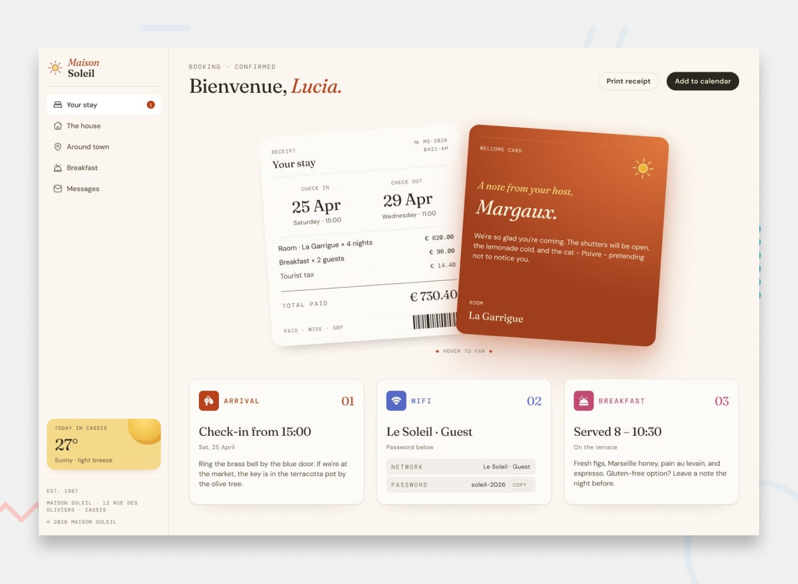

# Hotel Booking Confirmation

A responsive hotel booking confirmation page for **Maison Soleil**, a fictional boutique hotel in Cassis. The layout brings booking details, a personal welcome note, and practical guest information together in a warm, editorial-style interface.



*The image above is the supplied design reference, not a screenshot of this implementation.*

## Overview

This project is my solution to the [Hotel Booking Confirmation Page challenge on Frontend Mentor](https://www.frontendmentor.io/challenges/hotel-booking-confirmation-page).

The page is built with semantic HTML, custom CSS, and vanilla JavaScript. Its visual style combines a soft, sun-washed palette with Fraunces, DM Sans, and DM Mono typography.

### Features

- Responsive layout for desktop and smaller screens
- Mobile navigation that opens and closes with the menu controls, backdrop, or Escape key
- Booking receipt and welcome cards with a fan-out hover effect on desktop
- Guest information for arrival, Wi-Fi, and breakfast
- Locally bundled fonts and image assets

> **Note:** The print receipt, add to calendar, and Wi-Fi copy buttons are currently visual elements and are not wired to actions.

### Links

- [Source code](https://github.com/pettik/FrontendMentor--hotel-booking-confirmation-page)
- [Live site](https://pettik-hotel-booking-confirmation-pge.netlify.app/)
- [Figma design](https://www.figma.com/design/8bkHshTistvtNXbwRTymM3/hotel-booking-confirmation-page?node-id=22-2)

Screenshots of the implementation still need to be added.

## Built with

- Semantic HTML5
- CSS custom properties, Flexbox, and Grid
- Vanilla JavaScript
- Fraunces, DM Sans, and DM Mono

## AI collaboration

I used ChatGPT as a discussion partner while working on this project. We explored implementation approaches, discussed design and development decisions, and reviewed ideas for selected features. The collaboration helped me think through the solution and refine my approach as I built the page.

## Implementation lessons

- **Overlapping cards:** Flexbox reserves space for the receipt and welcome card, while transforms rotate and move them visually. Transforms do not move surrounding content, so the space below the cards must account for their rotated edges.
- **Responsive navigation and focus:** Moving the sidebar off-screen with a transform does not remove its links from the keyboard focus order. The script uses `inert` for the closed mobile sidebar and for the page behind an open menu. It synchronizes `aria-expanded`, moves focus into the menu, and restores it when the menu closes or the desktop breakpoint changes.
- **Typography and the cascade:** `0.875rem` keeps body text proportional to the reader's root font size. Removing overwritten declarations and selectors that match no elements makes it easier to trace the styles that actually affect the layout.

## Continued development

- Add desktop and mobile screenshots captured from the implementation, including the open mobile menu.
- Connect the receipt, calendar, and Wi-Fi copy controls to real actions.
- Check keyboard navigation after layout changes: a closed menu must be skipped by Tab, an open menu must keep focus inside it, and Escape must return focus to the menu button. Check both directions across the 75rem desktop breakpoint.

## Commit practices

Keep each future commit focused on one purpose and describe the resulting behavior. For example, use `fix: keep keyboard focus inside the mobile navigation` or `docs: explain card transforms and navigation focus` rather than `Update style.css` or `Update README.md`. Keep formatting-only changes separate from layout and interaction changes, and explain what a follow-up changes instead of repeating an earlier summary.

## Run locally

No build tools or package installation are required.

1. Clone the repository:

   ```bash
   git clone https://github.com/pettik/FrontendMentor--hotel-booking-confirmation-page.git
   ```

2. Open the project folder and launch `index.html` in your browser.

## Project structure

```text
.
├── assets/
│   ├── css/
│   ├── fonts/
│   ├── images/
│   └── js/
├── design/
├── index.html
└── preview.jpg
```

## Acknowledgments

- Challenge and design by [Frontend Mentor](https://www.frontendmentor.io)

## Author

- GitHub: [@pettik](https://github.com/pettik)
