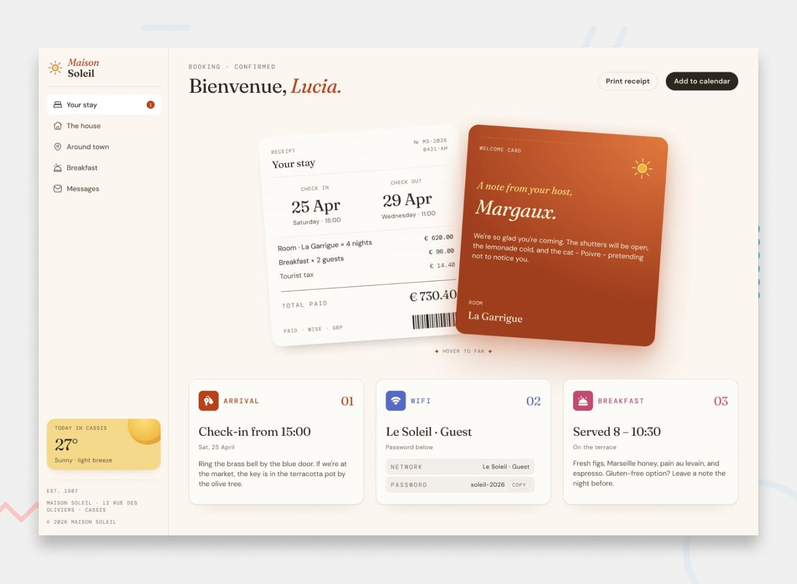

# Hotel Booking Confirmation

A responsive hotel booking confirmation page for **Maison Soleil**, a fictional boutique hotel in Cassis. The layout brings booking details, a personal welcome note, and practical guest information together in a warm, editorial-style interface.



## Overview

This project is my solution to the [Hotel Booking Confirmation Page challenge on Frontend Mentor](https://www.frontendmentor.io/challenges/hotel-booking-confirmation-page).

The page is built with semantic HTML, custom CSS, and vanilla JavaScript. Its visual style combines a soft, sun-washed palette with Fraunces, DM Sans, and DM Mono typography.

### Features

- Responsive layout for desktop and smaller screens
- Mobile navigation that opens and closes with the menu controls, backdrop, or Escape key
- Booking receipt and welcome cards with a fan-out hover effect on desktop
- Guest information for arrival, Wi-Fi, and breakfast
- Locally bundled fonts and image assets

> **Note:** The print receipt, add to calendar, and Wi-Fi copy buttons are currently visual elements and are not wired to actions.

## Built with

- Semantic HTML5
- CSS custom properties, Flexbox, and Grid
- Vanilla JavaScript
- Fraunces, DM Sans, and DM Mono

## Run locally

No build tools or package installation are required.

1. Clone the repository:

   ```bash
   git clone https://github.com/pettik/FrontendMentor--hotel-booking-confirmation-page.git
   ```

2. Open the project folder and launch `index.html` in your browser.

## Project structure

```text
.
├── assets/
│   ├── css/
│   ├── fonts/
│   ├── images/
│   └── js/
├── design/
├── index.html
└── preview.jpg
```

## Acknowledgments

- Challenge and design by [Frontend Mentor](https://www.frontendmentor.io)

## Author

- GitHub: [@pettik](https://github.com/pettik)
